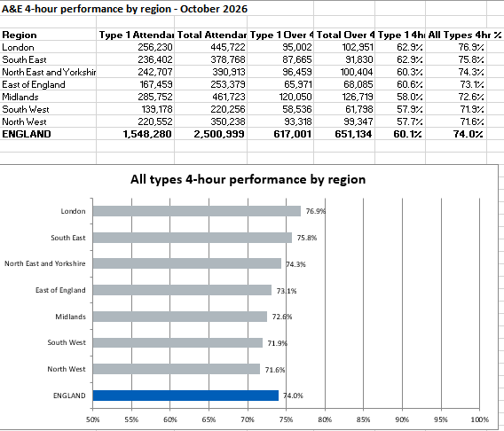

# NHS A&E Performance Report – Excel VBA Automation

One-click Excel VBA pipeline that turns the monthly NHS England A&E CSV into a regional 4-hour performance report, with a summary table, chart and PDF.



## Overview

Every month NHS England publishes A&E attendances and 4-hour waiting time data for every provider in England. Turning that raw file into a regional performance report by hand takes time and invites errors.

This project automates the whole process in Excel VBA. One button click:

```
CSV file ──► Raw ──► Clean ──► Summary ──► Chart ──► PDF
           import   validate   group by    bar     export
                    transform  region      chart
```

Tested on October 2026 and September 2026 data without code changes.

## Features

| Step | Macro | What it does |
|------|-------|--------------|
| 1 | `ImportRawData` | File picker, opens the CSV read-only, copies it untouched into the **Raw** sheet |
| 2 | `CleanData` | Validates headers, removes total and zero-activity rows, converts `MSitAE-OCTOBER-2026` to a real date, calculates Type 1 and all-types 4-hour performance |
| 3 | `BuildSummary` | Aggregates trusts by NHS region (Dictionary = SQL `GROUP BY`), adds an England total, sorts regions best to worst |
| 4 | `BuildChart` | Bar chart with England highlighted as the national benchmark |
| 5 | `ExportPDF` | Landscape one-page PDF named by month, e.g. `AE_Summary_2026-10.pdf` |
| – | `RunAll` | Runs the full pipeline from a button; stops cleanly if the import is cancelled |

## How to run

1. Download the monthly **A&E Attendances and Emergency Admissions** CSV from [NHS England](https://www.england.nhs.uk/statistics/statistical-work-areas/ae-waiting-times-and-activity/).
2. Open `AE_Automation.xlsm` in Excel for Windows and click **Enable Content**.
3. On the **Control** sheet, click **Run monthly report** and select the CSV.
4. The PDF report opens automatically and is saved next to the workbook.

## Data engineering techniques used

- **Layered design** – Raw (untouched copy) → Clean (validated) → Summary (aggregated), similar to bronze/silver/gold layers in a data lake
- **Schema validation** – header checks stop the run with a clear message if NHS England changes the file layout
- **Row-level validation** – only rows matching the `MSitAE-MONTH-YEAR` pattern are kept, so total rows can't double-count
- **In-memory processing** – data is read into arrays and written back in one step for speed
- **Idempotent runs** – each step clears its output first, so re-running gives the same result
- **Correct aggregation** – England and regional percentages are calculated from summed counts, not averaged percentages, matching NHS England methodology
- **Error handling** – every step reports failures clearly and restores Excel's state

## Example output (October 2026)

| Measure | England |
|---------|---------|
| Total attendances | 2,500,999 |
| All types seen within 4 hours | 74.0% |
| Type 1 seen within 4 hours | 60.1% |

## Project structure

```
├── AE_Automation.xlsm        Excel workbook with macros and Control button
├── AE_Automation.bas         VBA source code (readable on GitHub)
├── AE_Summary_2026-10.pdf    Example report
├── summary_AE.png            Summary sheet screenshot
└── control_AE.png            Control sheet screenshot
```

## Possible improvements

- Process several months in one run and chart the trend over time
- Add the 12-hour wait from decision to admit measure
- Compare performance against the NHS 4-hour target

## Data source and licence

Data: NHS England, *A&E Attendances and Emergency Admissions*, published under the [Open Government Licence v3.0](https://www.nationalarchives.gov.uk/doc/open-government-licence/version/3/).

## Author

**Emeka Chukwuma** – pharmacist with 20+ years' experience, MSc Health Informatics student (Swansea University), transitioning into data engineering.

GitHub: [ChukwumaEmeka](https://github.com/ChukwumaEmeka)
